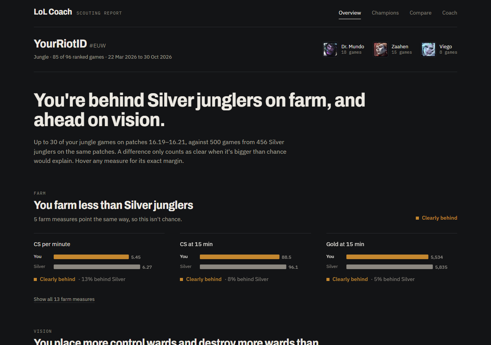
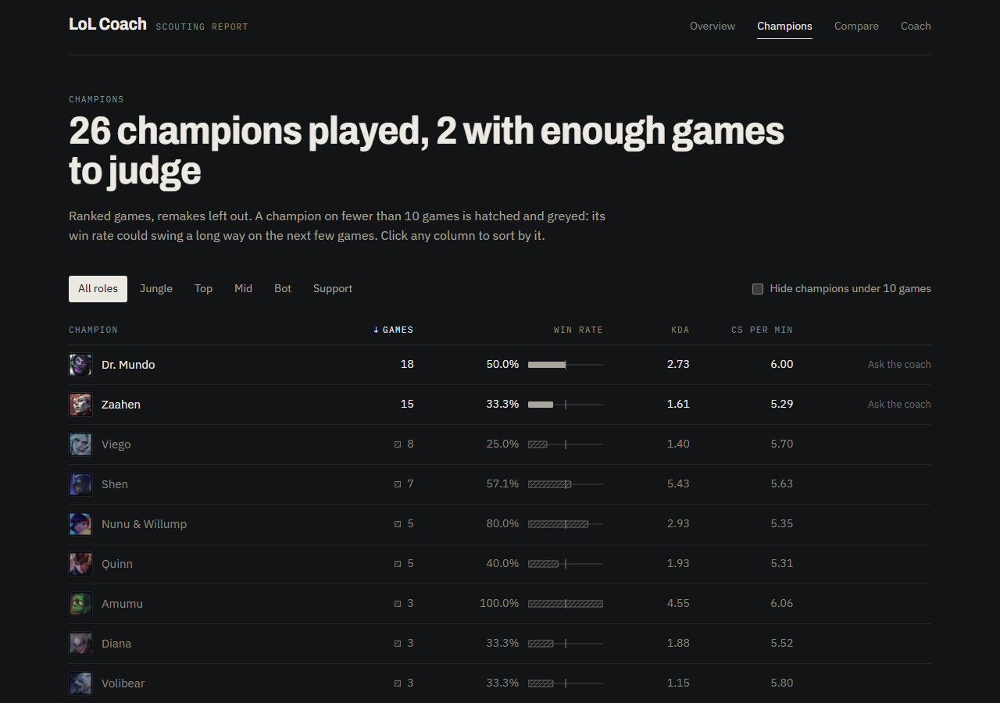
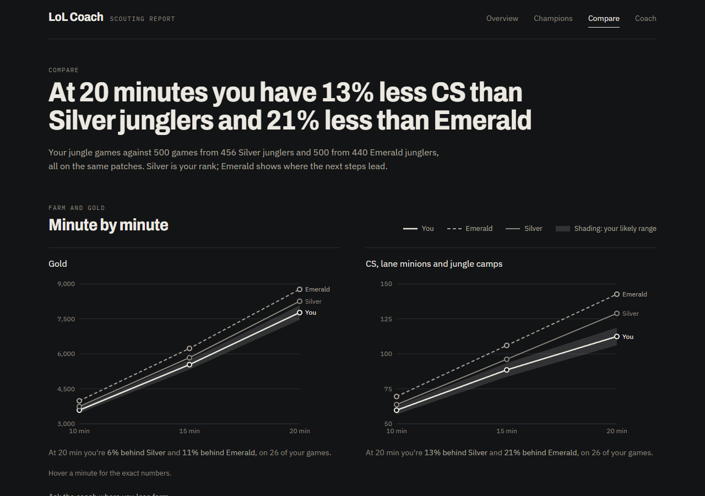
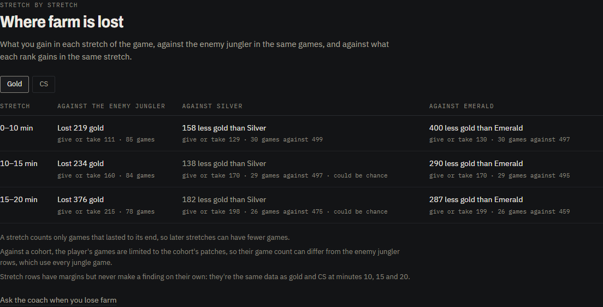
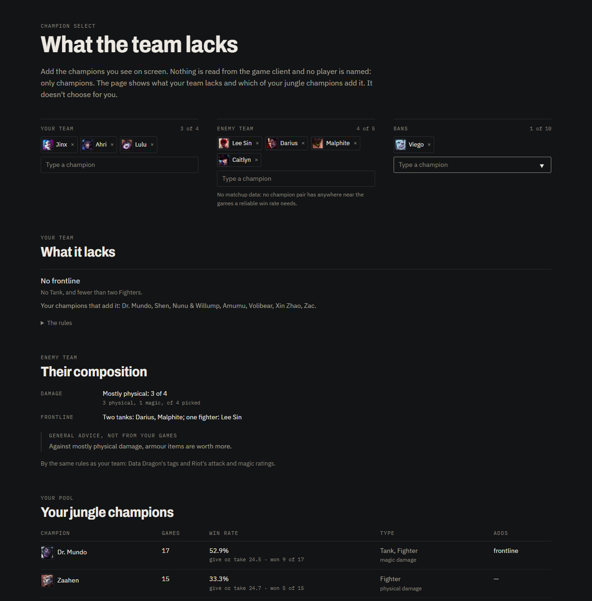
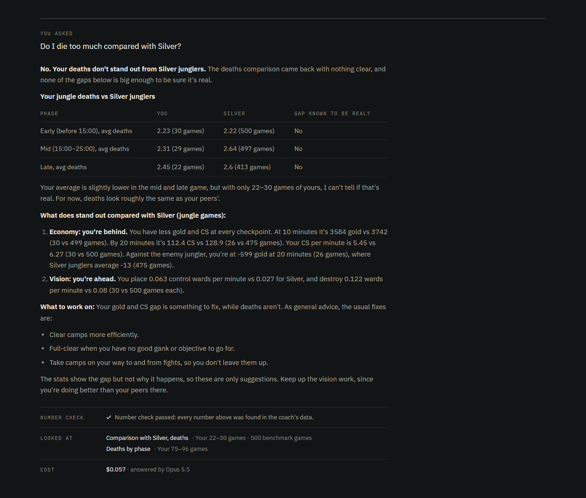

# LoL Coach

[](https://github.com/yuval3434/League-Of-Legends-Coach/actions/workflows/ci.yml)

A personal League of Legends coach, for any role. It pulls my matches from the
Riot API, computes every stat in SQL, compares them with real players of the same
rank and role, and uses an LLM agent to explain them in plain language. The model never
produces a number: it calls one tool per stat, and code checks that every number
in its answer appears in a tool result.



## Features

- **Match sync:** ranked games from the Riot API, every call through a rate
  limiter, with Riot's raw responses stored next to the parsed data.
- **Stats in SQL:** every stat comes with its sample size and a 95% margin, and
  says "not enough data" under 10 games.
- **Benchmarks:** comparisons with real players of your rank in your role,
  pulled on demand from the Overview with the time it takes; Emerald junglers
  are also a target for junglers below Emerald. A gap only counts as a finding
  when the data supports it.
- **Any role** (v8): each role is judged on its own measures, such as solo kills
  and lane plates for top, damage share for mid, and every ward a support
  places. With no benchmark yet, the Overview shows your own numbers, with wins
  against losses. The Draft pool and champion cards work in any role.
- **Farm by stretch** (v3): gold and CS lost from 0 to 10, 10 to 15 and 15 to 20
  minutes, against the enemy jungler and against each rank.
- **Coach:** an LLM agent with one tool per stat. Code checks every number in
  its reply against the tool results. Runs on Opus, Sonnet, Haiku or a free
  local model.
- **Number citations** (v9): on Claude models, every number in the coach's
  reply names the tool-result field it was copied from, and code checks it
  equals that field exactly. Hovering a number on the Coach page shows where it
  came from.
- **Champion select** (v4): what your team lacks and which of your champions add
  it. It never picks for you, and it has no matchup data.
- **Enemy composition** (v5): the enemy's damage mix and frontline, by the same
  rules, with one line of general build advice labelled as general advice.
- **Champion cards:** open a pool champion on the Draft page for your stats
  on it next to your overall average, each rank's benchmark on it, and Riot's
  own tips and ability text.
- **Options for this draft:** the coach's general notes on each of your
  champions against the enemy team, from Riot's text. Paid, so it shows the most
  it can cost first. No ranking, no pick, no claim about who wins.
- **Matches** (v5): your recent games, and each game's two teams with every
  champion's stats. Champions only, no player names.
- **Web app** (v2 to v5): Overview, Matches, Champions, Compare, Draft and Coach
  pages, plus Players and Settings. Fits a phone screen.
- **Several players:** sync friends and switch between them. Each player only
  gets the benchmarks that fit their rank and roles.
- **Eval:** 16 questions to the real coach, graded by code and by a model grader
  that is itself checked first.
- **Demo mode:** 12 anonymized games, no Riot key needed.

Where to read more:

- [The web app](#the-web-app): the pages.
- [DECISIONS.md](DECISIONS.md): why each stat works the way it does, with the data
  behind each choice.
- [Eval](#eval): how the coach is tested, and the latest results.
  [docs/EVAL.md](docs/EVAL.md) has every run and the eval's limits.
- [CLAUDE.md](CLAUDE.md): the project's rules.

**This is a personal tool, not a public service.** It runs on Riot's development
key, which is for personal use: a public app needs a production key approved by
Riot. Every coach question is also a paid model call, and the benchmark is built
from other players' matches, which belong in a local database rather than on a
server. LoL Coach isn't endorsed by Riot Games.

## The web app

A React app in [web/](web/) reads the API and draws; it never computes a stat.
Every verdict, gap, margin and percentage comes from the API. The screenshots are
my real games, with the Riot ID swapped for a placeholder.

```sh
cd web
npm install
npm run dev     # http://localhost:5173, with the API on port 8000
```

**Overview:** a headline written by code from the findings, then each theme's
telling measures as bars from zero, with a plain verdict and the gap in words.
Margins wait behind a hover. Context the verdict doesn't use, such as trinket
wards and vision score, sits under the theme marked "not judged" (above).

**Champions:** a role filter, a table sorted by any column, and each win rate's
range on hover. Champions on fewer than 10 games are hatched and greyed wherever
the sort puts them, and only champions with enough games offer "Ask the coach".



**Compare:** each of your roles against its cohorts at once: players of your
rank, and for junglers below Emerald, Emerald junglers as a target. Gold and CS
at 10, 15 and 20 minutes, with your likely range shaded, then every theme's
verdict against each.



Below the charts, **Where farm is lost** splits the early game into 0 to 10, 10
to 15 and 15 to 20 minutes. It shows the gold or CS gained in each stretch
against your lane opponent in the same games, the enemy player in the same
position, and against what each of the role's cohorts gains. Each cell has its margin and both sample sizes, and says
"could be chance" inside the margin or "too few games" under 10. These rows
never make a finding. `GET /benchmarks/stretches` and the coach's
`farm_by_stretch` tool return the same data.



**Draft:** champion select. You type in the champions on screen: your team's,
the enemy's and the bans. Nothing is read from the game client, and no player is
named. The page shows what your team lacks, using rules over Data Dragon's tags
and Riot's attack and magic ratings: no frontline, no magic damage, no physical
damage. It then lists which of your champions with 3 or more games in your
role add it, with their games and win rate, or "too early to tell" under 10 games. They
are listed most played first and never ranked, and the page never picks one:
Riot's League policy lists apps that dictate player decisions as unapproved.
The enemy team gets the same rules: its damage mix ("mostly physical: 3 of 4")
and its frontline, with one line of general build advice, labelled as general
advice and not from your games. One line under the enemy picks says there's no
matchup data, because no champion pair has anywhere near the games a reliable
win rate needs. Riot's own tips against each enemy pick follow, from Data
Dragon, labelled as general text that can be older than a champion's abilities.

Clicking a pool champion opens its card: your CS per minute, gold at 15,
deaths by phase and kill participation on it, next to your overall average in
that role, greyed with "too early to tell" under 10 games. Below that, each rank's
benchmark on that champion where it has 30 games from 10 players, and Riot's
tips and ability text.

**Options for this draft** asks the coach for each available champion's general
strengths and weaknesses against the enemy team, from Riot's text. It's one
capped model call with no tools, so the first click only counts the tokens, for
free, and shows the most it can cost; the second sends it. Sonnet 5.5 is the
default. `POST /draft` and the coach's
`draft_board` tool give the same board. [DECISIONS.md](DECISIONS.md) has the
policy quotes and the numbers.



**Matches:** your games, newest first, and a view of each one with both teams by
role: champion, K/D/A, CS, gold, damage and vision. Champions only, never a
player's name, and only games the selected player was in.

The stretch table and Draft screenshots are cropped below the page header instead
of swapping the Riot ID.

**Coach:** each reply comes with a receipt worked out by the server, not the
model: the number check, every tool called with the games it rested on, and the
cost. Questions are only sent on the Ask button.



The older Gradio UI in `ui/` still works, but the web app above is the one to use.

## Try it in demo mode

The demo has 12 of my jungle games with every player's identity replaced, so you
can try it without a Riot key. Requires Python 3.12, [uv](https://docs.astral.sh/uv/),
Docker and Node.js.

1. Copy `.env.example` to `.env`. Set `POSTGRES_PASSWORD`, and set
   `POSTGRES_DB=lolcoach_demo`.
2. Start the database and load the demo:
   ```sh
   docker compose up -d db
   uv run python -m demo.load
   ```
3. Start the API and the web app, then open http://localhost:5173:
   ```sh
   docker compose up --build -d api
   cd web
   npm install
   npm run dev
   ```

Every page but the Coach works as it is. **Asking the coach needs an Anthropic API key**
in `ANTHROPIC_API_KEY`, and each question is a paid call, usually a few cents to
about $0.30. With 12 games, most stats are under the 10-game floor, so expect
"not enough data" often: that's the coach being honest, not broken. The demo has
no benchmark, so comparisons say there isn't one.

**About the anonymization:** names, PUUIDs, summoner IDs, match IDs and real dates
are replaced, and the export refuses to write the file if any original value is
left. Stats and champions are kept, though. So someone who already knows my Riot
ID could find these games in a public match history and see who played in them.

## Setup with your own data

Requires Python 3.12, [uv](https://docs.astral.sh/uv/) and Docker.

1. Copy `.env.example` to `.env`, then set `RIOT_API_KEY` and `POSTGRES_PASSWORD`.
   Get a key from the [Riot Developer Portal](https://developer.riotgames.com).
   Development keys expire every 24 hours.
2. Start everything: `docker compose up --build -d`. This also applies migrations.

## Sync a player

```sh
curl -X POST localhost:8000/sync -H "Content-Type: application/json" \
  -d '{"game_name": "YourName", "tag_line": "TAG"}'
curl localhost:8000/sync/status
```

100 matches take about 4 minutes, because each match needs 2 calls and the limit
is 100 calls per 2 minutes. A sync can be run again safely: it fetches only what's
missing.

While the API runs, every synced player is also synced automatically every 30
minutes (`AUTO_SYNC_MINUTES` in `.env`; 0 turns it off), starting a minute after
the API starts. `GET /sync/auto` and the Players page show the last round. When
Riot refuses the key, every page shows a warning that links to Settings.

The first player synced is the owner: the default on every page and the one the
eval runs on. Other players can be added from the web app's Players page, and
their games stay in the same local database. Every stat, comparison and coach
answer is about one player, picked by the server; the model never sees or
chooses a PUUID. A player only gets a benchmark their rank and role fit: their
own rank's players in their main role and in any role with 10+ games, and Emerald
as a target for junglers below Emerald. Anyone else sees "no benchmark" and the
offer to pull one, never another player's or another rank's comparison. Ranks
are current solo/duo ranks, because match data doesn't record rank per game.

## Benchmarks

A cohort is one rank and one role: `silver` and `emerald` are junglers, and any
other is named like `gold_middle`, Gold mid laners. Each player gets their
peers' cohort in their main role and in any role with 10+ games, and junglers
below Emerald also get Emerald as a target. When a cohort has no benchmark yet,
the Overview offers to pull one, with the time it takes:

```sh
curl "localhost:8000/benchmarks/offers"                 # each role, its cohorts, the estimate
curl -X POST localhost:8000/benchmarks/pull -H "Content-Type: application/json" \
  -d '{"cohort": "gold_middle"}'                         # stops at 500 games
curl -X POST localhost:8000/benchmarks/pull -H "Content-Type: application/json" \
  -d '{"cohort": "gold_middle", "more": true}'           # 2,000 more matches, for champions
curl localhost:8000/benchmarks/status
curl "localhost:8000/benchmarks/compare?cohort=gold_middle"
curl "localhost:8000/benchmarks/compare?cohort=emerald&champion=Viego"
```

A pull to 500 games took 29 minutes for Gold mid laners on a development key. Scripts can still
pass `max_matches`, the cohort's running total of matches checked. Master and
above can't be pulled yet. A pull saves its progress as it goes and can be
started again after a key expires. It can't
run alongside a sync, because they share one call budget. Benchmark data stays in
the `benchmark` schema. [DECISIONS.md](DECISIONS.md) explains the rules.

After updating `RIOT_API_KEY`, run `docker compose up -d api`. `restart` keeps
the old key.

## Coach

The coach is an LLM agent with one tool per stat. Every number it states must
come from a tool result, and code checks that after each reply: a reply that
fails gets one retry, then is shown with a warning.

On Claude models the check is by citation. Every object in a tool result gets a
`ref`, such as `2.14`, and the coach writes each number followed by the field
it copied, as in `184[[2.14.avg_gold_diff]]`. Code checks that the number equals
that field exactly, with no rounding, and fails any uncited number except list
numbering, "1 in 20" and minute labels such as "at minute 15", which are checked
against the minutes the results define. The markers are removed before the
reply is shown, and on the Coach page hovering a number shows its source. The
local model keeps the older check, that each number appears somewhere in the
results. To see the check
catch a made-up number, with a scripted model and no paid calls:

```sh
docker compose up -d db
uv run python scripts/demo_number_check.py
```

To ask a question, which makes paid model calls (the first two cost $0.08 and
$0.14 on Opus 5.5):

```sh
curl -X POST localhost:8000/coach -H "Content-Type: application/json" \
  -d '{"question": "How is my farming compared with Silver?"}'
```

The response has the answer, its `status` (`verified` when every number passed
the check), the tools called and the token usage. `COACH_MODEL` in `.env` picks
the default model. `DECISIONS.md` explains what counts as a
finding and what the number check can't catch.

### Picking a model

The web app's Coach page has a model picker under the chat box: Opus 5.5,
Sonnet 5.5, Haiku 5.5 and a local model. Each shows an estimated cost per
question: the average token use of a real Opus answer in the last eval, priced
for that model (about $0.10, $0.05 and under $0.01). The choice is remembered in
the browser. `POST /coach` takes it as `"model"`, and `GET /coach/models` lists
the choices. Every model gets the same prompt, tools, benchmark rules and number
check.

### The local model

`"model": "local"` runs `qwen3:4b` in [Ollama](https://ollama.com) on this
computer: free, but several minutes per answer and less reliable. It was picked for a 4 GB GPU as the largest
model that fits there and supports tool calls.

```sh
ollama pull qwen3:4b
```

The context is set to 32,768 tokens, because a full comparison is about 12,000
and Ollama's default would silently cut tool results short. On a 4 GB GPU that
context doesn't fit in video memory, so most of the work runs on the CPU and an
answer takes several minutes. qwen3 also reasons in its answer even with
thinking off; only the text after its reasoning is kept, so the number check
never sees made-up numbers from it.

## API keys

The web app's Settings page replaces the Riot and Anthropic keys without a
restart. Each new key is tested with one cheap call first (Riot's server
status, through the rate limiter; listing Anthropic's models, which uses no
tokens) and saved to `.env` only if it works. `.env` stays the only place keys
live: Compose mounts it into the API container, which rewrites just the key's
line. No endpoint returns a key; the page sees only the last 4 characters, when
it was set and, for Riot, when it expires.

The settings endpoints only answer this computer's web app: the API port is
bound to `127.0.0.1`, the request must name `localhost` as its host, and it must
carry a header that only the app's own page sends. After changing `.env` by
hand, recreate the container (`docker compose up -d --force-recreate api`): a
restart keeps the old environment.

## Eval

The eval asks the real coach 16 questions and grades each answer. Checks that code
can do exactly are code: the number check passed, a tool was called, and the reply
says "no benchmark" for Dr. Mundo and "not enough data" for Viego. The rest are
graded by a model, Haiku 5.5, one call per property: a real number attached to the
wrong stat, gaps in different units ranked against each other, win-only or
loss-only rows presented as findings, claims the tools don't support, and numbers
written in words. For that last one, code first finds words like "twice" or
"thirty", and only replies with one go to the grader.

```sh
uv run python -m eval.run estimate                       # free
uv run python -m eval.run calibrate --reps 2 --confirm   # paid: grades the grader
uv run python -m eval.run live --confirm                 # paid: asks the coach
```

Paid modes print their cost estimate and refuse to run without `--confirm`.
Results, with every tool call and the grader's evidence, go to `eval/results/`.
Attempts that never produced an answer, such as timeouts, go to `errors.jsonl`,
so they never count as the coach failing.

The grader is checked before it's trusted: `calibrate` grades replies with known
verdicts, made by planting one error into a real coach reply, plus honest replies
it once got wrong. The latest run, two passes over 54 examples, agrees on all
108 gradings. Calibration also reports verdicts that change between passes, since
an earlier run's one miss was a grader that judged the same reply both ways.

### Latest results

| Run | Answered | Checks passed | Cost |
|---|---|---|---|
| Opus 5.5, all 16 cases, 2026-11-07 | 16 / 16 | 102 / 113 | $2.72 |
| Opus 5.5, 3 cases re-run after the fixes, 2026-11-08 | 3 / 3 | 18 / 20 | $0.48 |

In the full run, 15 of 16 answers passed the number check: `farming` dropped its
citations. In the re-run, the one coach failure left was a number from the right
field placed in the wrong sentence, which the number check can't see. The
run-by-run history, with every failure and what was fixed after it, is
in [docs/EVAL.md](docs/EVAL.md), along with the eval's limits.

## Backups

```sh
docker compose up -d db
uv run python scripts/backup.py
```

This writes the whole database to a dated, compressed file in `backups/`, which
git ignores. To restore one into an empty database:

```sh
docker compose exec -T db sh -c 'pg_restore -U "$POSTGRES_USER" -d <database>' < backups/<file>.dump
```

## Rate limiting

The limiter uses a sliding window even though Riot counts in fixed windows,
because we can't see when Riot's windows reset, and keeping every span under the
limit is safe wherever they start, at the cost of slightly lower throughput.

Its state lives in memory, so the app must run as a single process.

## Tests

```sh
docker compose up -d db
uv run pytest
```

Tests use a separate `lolcoach_test` database.

The frontend's type check is `npm run build`, which runs `tsc -b`: in this
project `tsc --noEmit` checks nothing, because the root `tsconfig.json` only
points to the real configs.

[CI](.github/workflows/ci.yml) runs on every push and pull request. The frontend
job runs `npm ci`, `npm run build` and `npm test`. The backend job runs ruff and
the whole suite against Postgres in a service container. No secret is set in CI,
and a step fails the run if an Anthropic or Riot key is present, so nothing can
reach a paid model. On CI, the tests fail instead of skipping when Postgres
can't be reached, so a green run means they ran.
